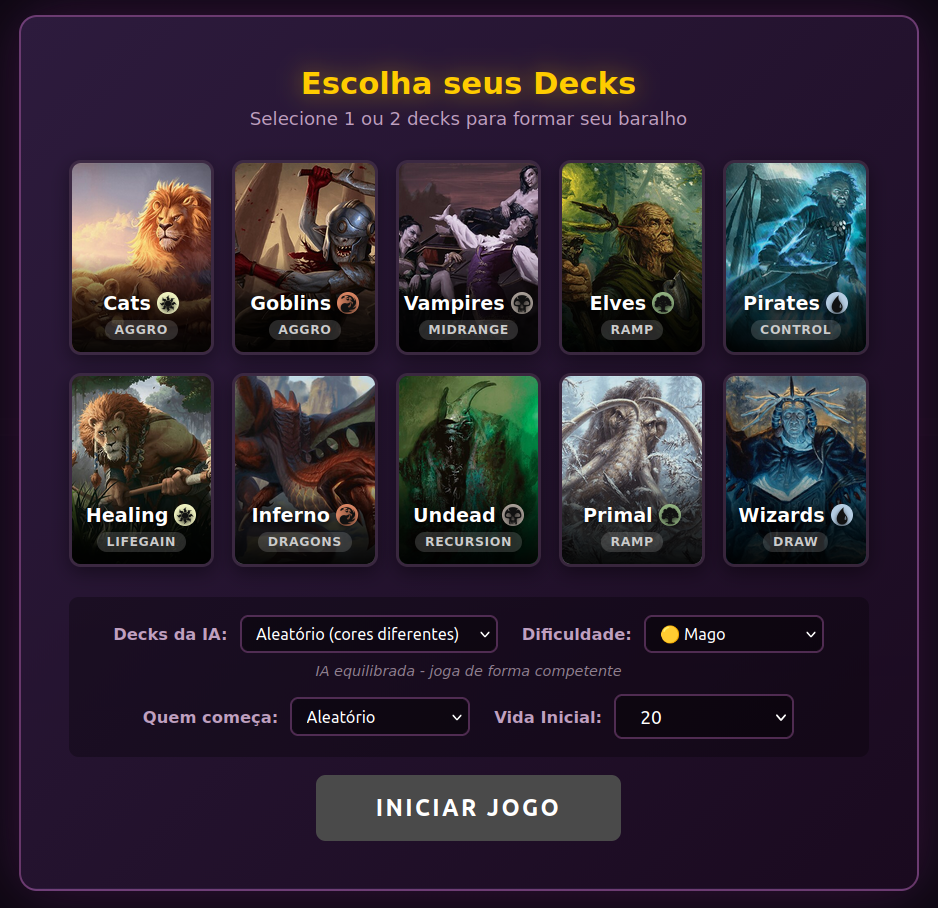
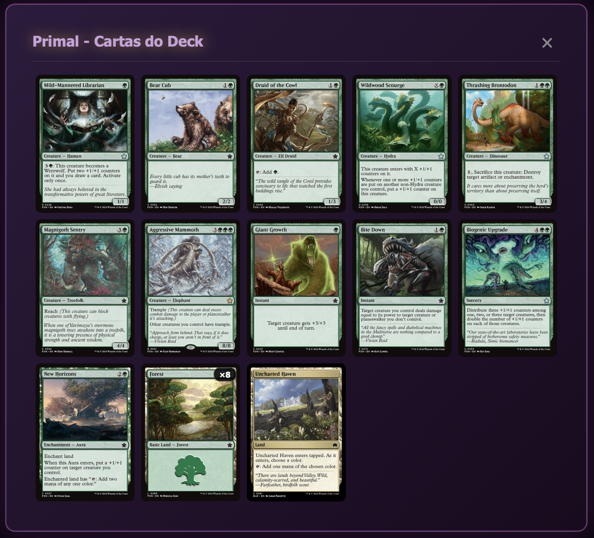
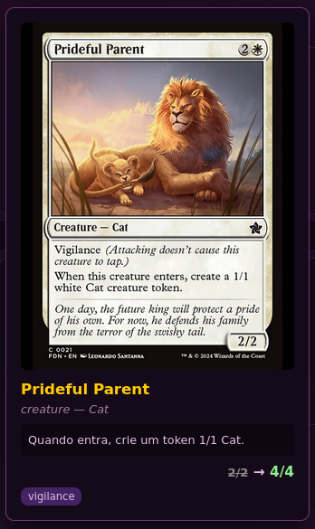
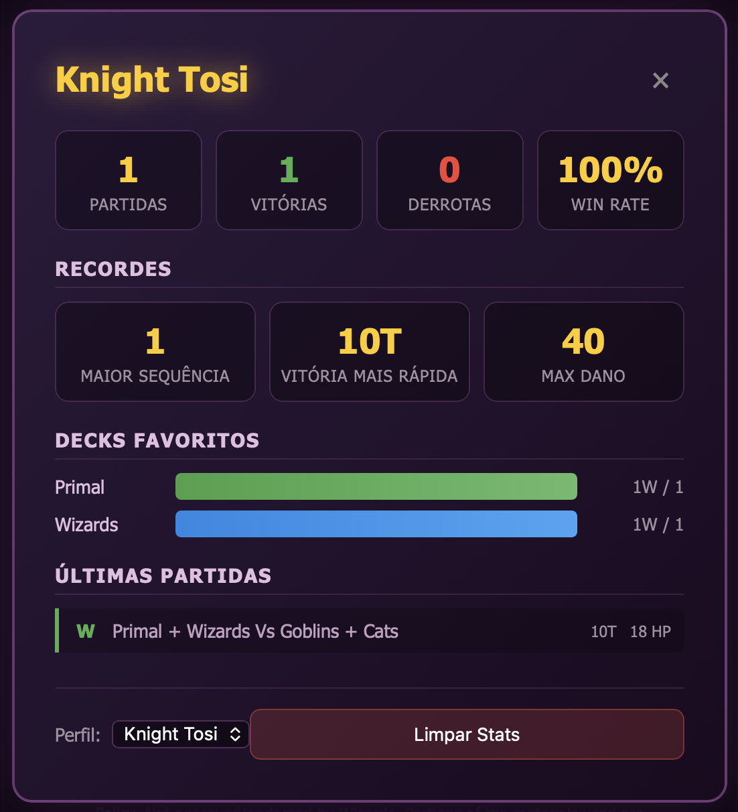

# MTG Jumpstart Foundations

[](https://github.com/lntosi/mtg-fdn/actions/workflows/tests.yml)


> **Legal Notice / Aviso Legal**
>
> This is an **unofficial, non-commercial fan project** created solely for **educational and personal learning purposes**. It is not intended for distribution as a product or game.
>
> **MTG Jumpstart Foundations** is unofficial Fan Content permitted under the [Fan Content Policy](https://company.wizards.com/en/legal/fancontentpolicy). Not approved/endorsed by Wizards of the Coast. Portions of the materials used are property of Wizards of the Coast. ©Wizards of the Coast LLC.
>
> Magic: The Gathering®, including card names, mana symbols, and game mechanics, are trademarks of Wizards of the Coast LLC. All card images are fetched from [Scryfall](https://scryfall.com/), a third-party API, and are property of their respective owners.
>
> **This repository contains source code only** — it is a programming exercise to learn JavaScript, game state management, and AI decision-making. If Wizards of the Coast requests removal, I will comply immediately.
>
> *Resumo em português:* projeto de fã, não oficial e sem fins comerciais, feito para estudo. Não é aprovado nem endossado pela Wizards of the Coast; Magic: The Gathering e seus elementos (nomes de cartas, símbolos de mana, mecânicas) são marcas da Wizards of the Coast LLC, e as imagens das cartas vêm do [Scryfall](https://scryfall.com/). Este repositório contém só código-fonte e será removido imediatamente se a Wizards of the Coast pedir. *Em caso de divergência, prevalece o texto em inglês.*

---

Um projeto educacional para aprender desenvolvimento de jogos, implementando mecânicas de Magic: The Gathering em JavaScript puro, desenvolvido com o [Claude Code](https://claude.com/claude-code).

> **Status: projeto concluído.** Desenvolvido entre dezembro de 2025 e fevereiro de 2026 (314 commits), este repositório é uma experiência fechada e autocontida. Ele não recebe novas funcionalidades nem correções, e fica público como referência para outros fãs que queiram construir algo parecido.

## Propósito Educacional

Este projeto foi criado para:
- 📚 **Aprender JavaScript** — manipulação de DOM, classes ES6+, async/await
- 🎮 **Estudar game design** — máquinas de estado, sistemas de turnos, IA básica
- 🧪 **Praticar TDD** — 694 testes automatizados com Jest
- 🃏 **Entender MTG** — regras, interações de cartas, sistema de prioridade
- 🤖 **Experimentar desenvolvimento com IA** — todo o código foi escrito em parceria com o Claude Code

**Não é um produto para distribuição.** É código-fonte para estudo.

---

## Sobre

Jogo de MTG contra a IA, baseado nos 10 decks Jumpstart do **Foundations Beginner Box**: 10 packs de 20 cartas, com 124 cartas distintas. Jogue com 1 pack (20 cartas) ou combine 2 num deck de 40, com vida inicial configurável (20 por padrão).

**Todos os 10 decks implementados** ✅

| Deck | Cor | Estratégia | Carta Destaque |
|------|:---:|------------|----------------|
| **Cats** |  | Vínculo de vida e fichas | <a href="https://scryfall.com/card/fdn/21/prideful-parent"></a> |
| **Goblins** |  | Ímpeto e dano direto | <a href="https://scryfall.com/card/fdn/543/raging-redcap"></a> |
| **Vampires** |  | Dreno de vida e voar | <a href="https://scryfall.com/card/lcc/190/crossway-troublemakers"></a> |
| **Elves** |  | Aceleração de mana | <a href="https://scryfall.com/card/fdn/219/elvish-archdruid"></a> |
| **Pirates** |  | Lampejo, anular e devolver | <a href="https://scryfall.com/card/fdn/164/spectral-sailor"></a> |
| **Healing** |  | Gatilhos de ganho de vida | <a href="https://scryfall.com/card/fdn/135/ajanis-pridemate"></a> |
| **Inferno** |  | Dragões | <a href="https://scryfall.com/card/fdn/549/terror-of-mount-velus"></a> |
| **Undead** |  | Recursão do cemitério | <a href="https://scryfall.com/card/m19/90/death-baron"></a> |
| **Primal** |  | Criaturas grandes e marcadores | <a href="https://scryfall.com/card/fdn/551/aggressive-mammoth"></a> |
| **Wizards** |  | Compra e sinergias de mágicas | <a href="https://scryfall.com/card/fdn/37/erudite-wizard"></a> |

## Screenshots

<table>
<tr>
<td align="center"><strong>Seleção de Avatar</strong><br></td>
<td align="center"><strong>Seleção de Decks</strong><br></td>
<td align="center"><strong>Conferir Deck</strong><br></td>
<td align="center"><strong>Mulligan</strong><br></td>
</tr>
</table>

### Campo de Batalha


<table>
<tr>
<td align="center"><strong>Preview de Carta</strong><br></td>
<td align="center"><strong>Estatísticas</strong><br></td>
</tr>
</table>

## Como Jogar

1. Abra `index.html` no navegador
2. Personalize seu jogador (nome e avatar)
3. Selecione 1 ou 2 decks (20 ou 40 cartas)
4. A IA selecionará a mesma quantidade de decks aleatoriamente
5. Vença reduzindo a vida do oponente a 0!

## Funcionalidades

### Regras Implementadas
- Fases de turno completas (Untap, Upkeep, Draw, Main, Combat, End)
- Sistema de mana colorido com pagamento automático
- Combate com atacantes e bloqueadores múltiplos
- London Mulligan (compra 7, escolhe cartas para o fundo)
- Descarte para 7 cartas no fim do turno
- Morte por deck vazio (mill)

### Keywords
`Flying` `Lifelink` `Deathtouch` `Trample` `First Strike` `Double Strike` `Vigilance` `Haste` `Reach` `Menace` `Flash` `Ward` `Hexproof` `Indestructible`

### Mecânicas Avançadas
- **Stack e Prioridade**: Sistema completo com janelas de resposta
- **Priority Stops**: Configuráveis estilo MTG Arena (Upkeep, Combat, End Step)
- **Counterspells**: Cancel, Essence Scatter (creature-only)
- **Equipment**: Pirate's Cutlass com ETB attach e Equip ativado
- **Auras**: Pacifism, Untamed Hunger, Eaten by Piranhas, Starlight Snare
- **Contadores**: +1/+1 e -1/-1 com visualização
- **Ward**: Proteção com custo de mana
- **Scry**: Opt com visualização da carta
- **Raid**: Triggers condicionais ao atacar
- **Lords**: Elfos, Goblins, Piratas, Zombies/Skeletons (Death Baron)
- **Lifegain Triggers**: Ajani's Pridemate, Twinblade Paladin
- **Draw Triggers**: Clinquant Skymage, Erudite Wizard, Mischievous Mystic
- **Graveyard Recursion**: Gravedigger, Rot Hulk, Rise Again
- **Dragon Synergy**: Custo reduzido, haste condicional
- **Fight**: Bite Down (one-sided fight)
- **Kicker**: Into the Roil com efeito adicional
- **Must Be Blocked**: Joraga Invocation força bloqueio

### Interface
- Imagens das cartas via Scryfall API
- Avatares de planeswalkers (Jace, Chandra, Liliana, Gideon, Nissa, Ajani)
- Preview ampliado com stats calculados (base → buffs → dano)
- Visualização de dano em criaturas (badges e stats vermelhos)
- Linhas de conexão atacante-bloqueador
- Stack badge com hover dropdown
- Menu de configurações (tecla ESC)
- 3 temas visuais
- Efeitos sonoros e música de fundo (volumes independentes)
- Histórico de partida exportável
- Estatísticas persistentes por perfil de jogador
- Modo tela cheia

### IA Inteligente
- Avalia trades e bloqueios estratégicos
- Usa habilidades ativadas
- Reserva mana para respostas com instants
- Verificação de sobrevivência (não ataca se morre no contra-ataque)
- Mulligan inteligente (avalia terrenos e curva de mana)

## Como foi feito com o Claude Code

O projeto inteiro foi desenvolvido em conversas com o [Claude Code](https://claude.com/claude-code). Se você quer fazer algo parecido, é assim que o trabalho foi organizado:

- **[CLAUDE.md](CLAUDE.md)**: o guia que o Claude Code lê a cada sessão, com a arquitetura, a responsabilidade de cada arquivo, a árvore de decisão para encaixar habilidades de cartas e os padrões de código.
- **Armadilhas registradas**: a seção *Pitfalls* do `CLAUDE.md` guarda os bugs que se repetiram (convenção do topo do grimório, counterspells, async/await), para o Claude Code não cair neles de novo.
- **Auditorias multiagente**: 13 rodadas em que vários agentes jogaram partidas e revisaram regras, cartas e IA em paralelo, encontrando 106 bugs e acrescentando 198 testes de regressão.
- **As [Regras Completas](https://magic.wizards.com/en/rules)** do Magic, consultadas para implementar mecânicas e corrigir bugs de regras.

## Tecnologias

- **Vanilla JavaScript** (ES6+) — zero dependências em runtime
- **CSS3** com animações e transições
- **HTML5**
- **[Scryfall API](https://scryfall.com/)** para imagens
- **LocalStorage** para configurações e estatísticas
- **[Jest](https://jestjs.io/)** para testes automatizados

## Estrutura do Projeto

```
mtg-fdn/
├── index.html              # Página principal
├── css/
│   └── style.css           # Estilos e tema Foundations
├── js/
│   ├── main.js             # Inicialização
│   ├── game.js             # Estado e fluxo do jogo
│   ├── rules.js            # Motor de regras MTG
│   ├── triggers.js         # Triggers de cartas (ETB, death, combat)
│   ├── ai.js               # Inteligência artificial
│   ├── ui.js               # Interface e renderização
│   ├── cards.js            # Base de dados das cartas
│   ├── sounds.js           # Efeitos sonoros
│   ├── images.js           # Imagens das cartas (Scryfall API)
│   ├── stats.js            # Estatísticas do jogador (localStorage)
│   ├── logs.js             # Histórico da partida
│   └── settings.js         # Configurações (som, prioridade, etc.)
├── assets/sounds/          # Efeitos sonoros e músicas
├── tests/                  # Testes automatizados (Jest)
├── tools/
│   └── validate-cards.js   # Validação de cartas via Scryfall (ver limitações)
├── screenshots/            # Screenshots da aplicação
├── package.json            # Configuração npm e Jest
└── CLAUDE.md               # Guia para Claude Code
```

## Testes Automatizados

O projeto inclui **694 testes** (20 suites) cobrindo:
- Mecânicas de combate (first strike, trample, deathtouch)
- Keywords e interações
- Triggers de criaturas (ETB, death, combat)
- Habilidades de lords
- Feitiços e efeitos
- Sistema de estatísticas do jogador
- Regressões encontradas nas auditorias multiagente

```bash
# Instalar dependências
npm install

# Rodar testes
npm test
```

Para testar à mão no navegador, o console tem comandos de debug (`debug.help()` lista todos).

## Limitações Conhecidas

O projeto está encerrado no estado em que se encontra. Estas limitações ficam documentadas para quem for estudar o código:

- **Stack parcial**: mágicas sem alvo resolvem sem passar pela pilha, e a IA responde a uma contramágica, mas não entra em disputas mais longas.
- **Alvos simplificados**: alguns feitiços só aceitam alvos do lado mais útil (Giant Growth só nas suas criaturas, Scorching Dragonfire só nas do oponente), embora o texto Oracle permita qualquer criatura.
- **`tools/validate-cards.js` não funciona mais**: o script não encontra as cartas no Scryfall e reporta todas como "Not found". As cartas foram conferidas contra o Scryfall durante as auditorias.
- **Interface pensada para desktop**: otimizada para zoom de 70–80% no navegador, sem layout para celular.

## Créditos

- Imagens: [Scryfall](https://scryfall.com/)
- Sons: [Pixabay](https://pixabay.com/)
- Símbolos de mana: [Mana font](https://mana.andrewgioia.com/)
- Inspirado no projeto [Forge](https://github.com/Card-Forge/forge)

---

*Veja o aviso legal completo no topo deste documento.*
