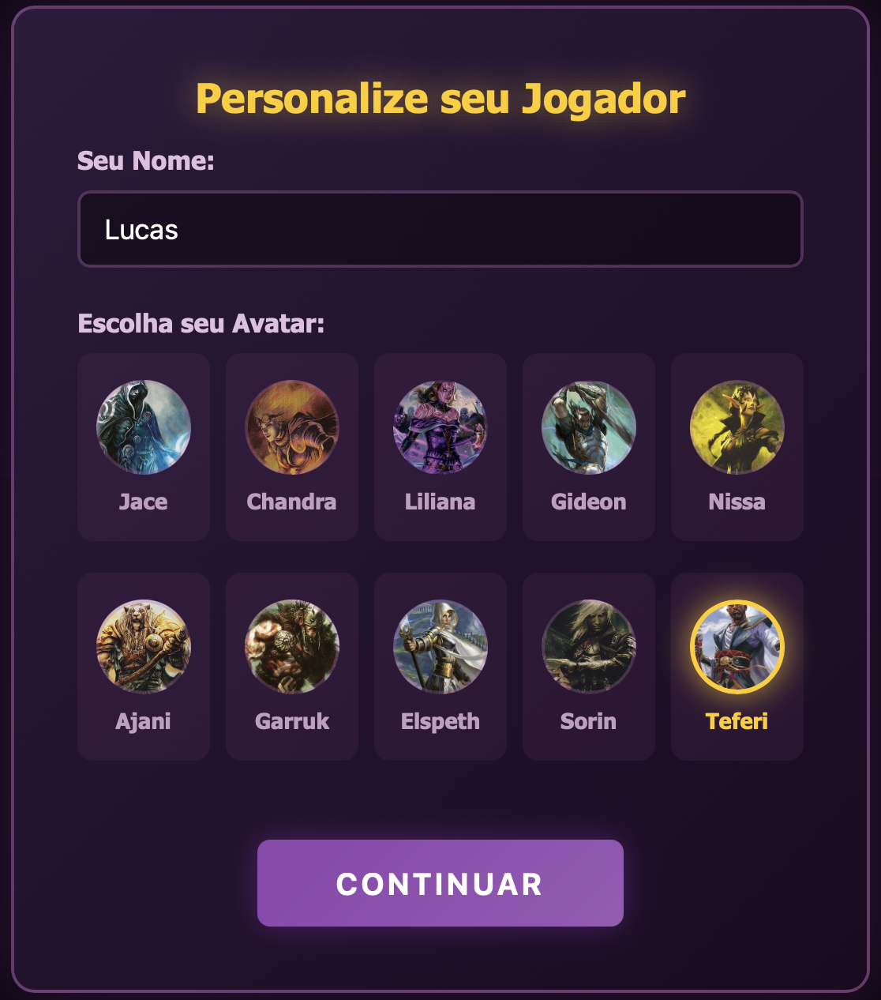
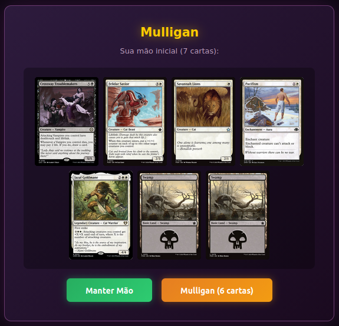
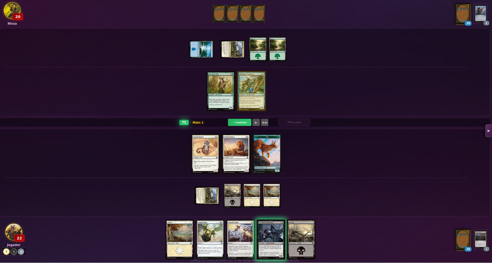

# MTG Jumpstart Foundations

Um jogo de Magic: The Gathering para navegador, focado em aprendizado e prática contra IA.


## Sobre

Jogo offline de MTG usando os 4 decks Jumpstart do **Foundations Beginner Box**:

| Deck | Cor | Estratégia | Carta Destaque |
|------|:---:|------------|----------------|
| **Cats** |  | Criaturas com lifelink e tokens | <a href="https://scryfall.com/card/ddg/7/leonin-skyhunter"></a> |
| **Goblins** |  | Agressivo com haste e dano direto | <a href="https://scryfall.com/card/fdn/543/raging-redcap"></a> |
| **Vampires** |  | Dreno de vida e flying | <a href="https://scryfall.com/card/mid/125/vampire-interloper"></a> |
| **Elves** |  | Ramp de mana e criaturas grandes | <a href="https://scryfall.com/card/fdn/219/elvish-archdruid"></a> |

## Screenshots

### Seleção de Avatar


### Tela de Mulligan


### Gameplay


## Como Jogar

1. Abra `index.html` no navegador
2. Personalize seu jogador (nome e avatar)
3. Selecione 2 decks para formar seu baralho de 40 cartas
4. A IA jogará com os 2 decks restantes
5. Vença reduzindo a vida do oponente a 0!

## Funcionalidades

### Regras Implementadas
- Fases de turno completas (Untap, Upkeep, Draw, Main, Combat, End)
- Sistema de mana e pagamento de custos
- Combate com atacantes e bloqueadores
- Dano de combate e dano direto

### Keywords
Flying, Lifelink, Deathtouch, Trample, First Strike, Double Strike, Vigilance, Haste, Reach, Menace

### Habilidades de Criaturas
- **Lords**: Elvish Archdruid (+1/+1 para Elfos), Dropkick Bomber (+1/+1 para Goblins)
- **Triggers ETB**: Beast-Kin Ranger, Vampire Spawn, Dwynen's Elite
- **Triggers de Combate**: Battle-Rattle Shaman, Leonin Vanguard

### Interface
- Imagens das cartas via Scryfall API
- Avatares de planeswalkers (Jace, Chandra, Liliana, Gideon, Nissa, Ajani)
- Visualização de dano em criaturas
- Histórico de partida
- Efeitos sonoros
- Auto-save (persiste ao recarregar página)

### IA
- Estratégia básica de jogo
- Decisões de combate (atacar/bloquear)
- Delays visuais entre ações

## Tecnologias

- Vanilla JavaScript (ES6+)
- CSS3 com animações
- HTML5
- [Scryfall API](https://scryfall.com/) (imagens)
- LocalStorage (persistência)
- [Jest](https://jestjs.io/) (testes automatizados)

## Estrutura do Projeto

```
mtg/
├── index.html              # Página principal
├── css/
│   └── style.css           # Estilos e tema Foundations
├── js/
│   ├── main.js             # Inicialização
│   ├── game.js             # Estado e fluxo do jogo
│   ├── rules.js            # Motor de regras MTG
│   ├── ai.js               # Inteligência artificial
│   ├── ui.js               # Interface e renderização
│   ├── cards.js            # Base de dados das cartas
│   ├── sounds.js           # Efeitos sonoros (Pixabay)
│   └── images.js           # Imagens das cartas (Scryfall API)
├── tests/
│   ├── helpers/
│   │   ├── gameFactory.js  # Factory functions para testes
│   │   └── rulesEngine.js  # Motor de regras simplificado
│   ├── combat.test.js      # Testes de combate
│   ├── triggers.test.js    # Testes de triggers
│   ├── spells.test.js      # Testes de feitiços
│   ├── keywords.test.js    # Testes de keywords
│   └── lords.test.js       # Testes de lords
├── screenshots/            # Screenshots da aplicação
├── package.json            # Configuração npm e Jest
├── CLAUDE.md               # Guia para Claude Code
├── ROADMAP.md              # Plano de desenvolvimento
└── TESTING.md              # Guia de testes automatizados
```

## Testes Automatizados

O projeto inclui 111 testes automatizados cobrindo:
- Mecânicas de combate
- Keywords e interações
- Triggers de criaturas
- Habilidades de lords
- Feitiços e efeitos

```bash
# Instalar dependências
npm install

# Rodar testes
npm test
```

Veja [TESTING.md](TESTING.md) para mais detalhes.

## Roadmap

Veja [ROADMAP.md](ROADMAP.md) para o plano completo de desenvolvimento, incluindo:
- Efeitos de cartas pendentes
- Melhorias de UI/UX
- Melhorias de IA
- Novos conteúdos planejados

## Créditos

- Imagens: [Scryfall](https://scryfall.com/)
- Sons: [Pixabay](https://pixabay.com/)
- Inspirado no projeto [Forge](https://github.com/Card-Forge/forge)

---

*Projeto pessoal para aprendizado. Magic: The Gathering é marca registrada da Wizards of the Coast.*
